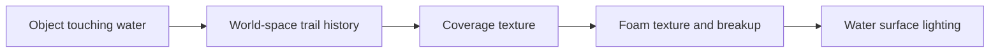

# godot-ocean-packages

https://github.com/user-attachments/assets/60019bff-a44c-491b-b4c8-ed0704908fe7

Two reusable packages for building ocean scenes in **Godot 4.7**:

- **GodotOceanWaves** provides GPU-generated ocean waves, water rendering, height queries, and object interaction effects.
- **Boat System** provides reusable pontoon buoyancy for boats and simple floating objects, plus optional engines, player controls, and a follow camera.

Use the ocean on its own for water rendering and interaction effects, or combine both packages to float objects and create controllable boats with foam trails and splashes. The included demo brings them together. Buoyancy is implemented entirely in Boat System; GodotOceanWaves supplies the water height data.

The ocean package is independently maintained and based on [GodotOceanWaves](https://github.com/2Retr0/GodotOceanWaves) by [2Retr0](https://github.com/2Retr0). The original ocean implementation and its development history belong to their respective authors.

## Index

- [Installation](#installation)
- [Demo scene](#demo-scene)
- [GodotOceanWaves](#godotoceanwaves)
  - [Changes from the original project](#changes-from-the-original-project)
  - [Ocean settings](#ocean-settings)
  - [Water height queries](#water-height-queries)
  - [Rendering features](#rendering-features)
  - [Object interactions: foam and splashes](#object-interactions-foam-and-splashes)
  - [How the interaction shaders work](#how-the-interaction-shaders-work)
- [Boat System](#boat-system)
  - [Scene structure and setup](#scene-structure-and-setup)
  - [Floating simple objects](#floating-simple-objects)
  - [Ordered physics updates](#ordered-physics-updates)
  - [Pontoon buoyancy and water resistance](#pontoon-buoyancy-and-water-resistance)
  - [Engine and acceleration pitch](#engine-and-acceleration-pitch)
  - [Player controls](#player-controls)
  - [Follow camera](#follow-camera)
  - [Custom controllers and propulsion](#custom-controllers-and-propulsion)
- [Credits and license](#credits-and-license)

## Installation

The included project targets **Godot 4.7 with the Forward+ renderer**. The ocean uses GPU compute shaders through `RenderingDevice`.

1. Download or clone this repository.
2. Copy the packages you need into your project's `res://packages/` directory, keeping their folder names and paths intact.
3. For the ocean, copy the shader global definitions from the `[shader_globals]` section of [project.godot](project.godot) into your project's configuration, preserving any existing globals. These bindings are updated by the ocean at runtime:

   | Name | Type |
   | --- | --- |
   | `displacements` | `sampler2DArray` |
   | `normals` | `sampler2DArray` |
   | `water_color` | `color` |
   | `foam_color` | `color` |
   | `num_cascades` | `uint` |

4. Instance [godot_ocean_waves.tscn](packages/godot_ocean_waves/godot_ocean_waves.tscn) in your scene. Assign its **Player** property to the camera or node the ocean should follow, then adjust its Inspector settings.
5. For buoyancy, import Boat System and follow the setup for a [boat](#scene-structure-and-setup) or a [simple floating object](#floating-simple-objects). Enable **Physics > Common > Physics Interpolation** in Project Settings for smooth body and camera motion.

Expected structure:

```text
your-project/
+-- packages/
|   +-- godot_ocean_waves/
|   |   +-- godot_ocean_waves.tscn
|   |   +-- assets/
|   |       +-- godot_ocean_waves.gd
|   |       +-- interactions/
|   |       |   +-- ocean_interactions.gd
|   |       |   +-- ocean_interactor.gd
|   |       +-- shaders/
|   |       +-- water/
|   |       +-- ...
|   +-- boat_system/
|       +-- boat_system.gd
|       +-- components/
|       |   +-- boat_component.gd
|       |   +-- boat_buoyancy.gd
|       |   +-- boat_engine.gd
|       +-- utils/
|           +-- boat_follow_camera.gd
|           +-- boat_player_input.gd
|           +-- boat_system_debug_draw.gd
+-- project.godot
```

GodotOceanWaves can be imported independently. Boat System samples a water provider through `get_height(world_position)`; assign the GodotOceanWaves node when using these packages together.

## Demo scene

Open this repository's [project.godot](project.godot) in Godot and run [demo.tscn](demo.tscn). The demo includes the ocean, a speedboat, lighting, and a follow camera. It uses Jolt Physics and enables physics interpolation.

The demo's procedural sky, sun, brighter water colors, and distance fog create a sunny ocean scene. Fog blends the distant water into the horizon before the mesh ends. Adjust the demo's `WorldEnvironment`, `Sun`, and ocean instance to change this appearance.

The game starts **maximized**, fitting the current monitor's available area. Its rendering resolution follows the actual window size, including resizing, with the 3D render scale at 100%. For edge-to-edge native-resolution play, change **Project Settings > Display > Window > Size > Mode** to **Fullscreen**. The window mode controls its desktop size; the existing **Canvas Items** stretch mode and **Expand** aspect setting control how content adapts inside it.

When playing inside the editor's Game view, choose **Stretch to Fit** to fill that view. To test the native maximized or fullscreen window, turn off **Embed Game on Next Play** in the Game view menu before running the project.

Use **WASD** to choose a movement direction relative to the camera. The boat turns toward that direction and applies forward thrust as it lines up. Releasing the keys cuts the engine command, letting water resistance slow the boat. Hold the **right mouse button** and move the mouse to orbit around the boat. Release the button or press **Escape** to free the cursor.

The example boat is [demo_assets/boat/boat.tscn](demo_assets/boat/boat.tscn). Copy `demo_assets/boat/` as well if you want to reuse that scene and its model in another project. Visual results depend on your lighting, environment, and rendering settings.

## GodotOceanWaves

GodotOceanWaves combines ocean rendering, wave simulation, audio, and water height queries in one scene. Its public controls live on the **GodotOceanWaves** root node; the `Water` child owns the wave generation and rendering resources.

### Changes from the original project

- Updated compatibility for Godot 4.7.
- Consolidated the ocean into a single scene that can be instanced in another project.
- Configured a single wave cascade to simplify tuning and keep CPU height sampling consistent with the rendered surface. The original project uses three cascades. A single cascade can make texture repetition more noticeable at a distance.
- Exposed the essential settings on the root node. More advanced wave and rendering settings remain available in the underlying resources, scripts, and shaders.
- Added asynchronous displacement texture readback through `RenderingDevice.texture_get_data_async()`.
- Added ocean-owned object foam and splashes, including automatic collider detection and persistent trails.

### Ocean settings

| Property | Purpose |
| --- | --- |
| `player` | Node used to reposition the water mesh as it moves, keeping the ocean around the viewer. The demo assigns the camera. |
| `water_color` | Tint of the water surface. |
| `foam_color` | Shared color for wave foam, object trails, contact foam, and splashes. |
| `wind_speed` | Wind speed in meters per second. Higher values generally produce steeper, more chaotic waves and more foam. |
| `wind_direction` | Wind direction in degrees: `0` points along positive X and `90` along positive Z. |
| `enable_audio` | Enables or pauses the ocean and wind audio. |
| `enable_get_height` | Enables displacement readback for water height queries. Required by buoyancy and automatic object-contact detection. |

### Water height queries

The root ocean script exposes:

```gdscript
get_height(world_pos: Vector3) -> float
```

Pass a world-space position to obtain the estimated water surface height at its XZ coordinates. This supports buoyancy, floating objects, and gameplay that needs to locate the water surface.

For example, from a script with an assigned ocean reference:

```gdscript
var surface_height: float = ocean.get_height(global_position)
```

Height data comes from an **asynchronous GPU readback**. This avoids waiting synchronously for the GPU to finish, but the CPU data can lag the visible waves by several frames, depending on workload and readback timing. Calling `get_height()` with **Enable Get Height** disabled reports an error.

Disable height queries when your scene does not need buoyancy, height-based gameplay, or automatic object interactions. Performance depends on the hardware, wave settings, and number of queries.

### Rendering features

**GPU wave simulation.** The wave generator uses FFT-based displacement and normal maps. The water shader samples these maps to move the ocean mesh and shade its surface. Wind settings control the simulated wave conditions.

**Large ocean meshes.** The package includes clipmap meshes with multiple levels of detail, including an 8 km variant. They retain more geometric detail near the camera and use coarser geometry farther away. Mesh quality, displacement falloff, and rendering settings determine the effective visual coverage.

**Wave foam and spray.** Breaking waves generate surface foam and airborne spray. Object interactions reuse the ocean's foam texture, color, and existing particle system.

**Waterline fade.** Scene depth softens the transition where the water intersects opaque geometry.

**Depth-dependent visibility.** The shader tints submerged objects and blends their screen color into the water according to depth. Its absorption ranges can be tuned in [water.gdshader](packages/godot_ocean_waves/assets/shaders/spatial/water.gdshader):

```glsl
uniform vec3 depth_color_consumption = vec3(7.5, 22.0, 38.0);
```

### Object interactions: foam and splashes

The ocean automatically detects `CollisionObject3D` nodes, including `RigidBody3D`, `CharacterBody3D`, `StaticBody3D`, `AnimatableBody3D`, and `Area3D`. Moving colliders can leave foam without an effects script. Bare meshes need a collider or an optional interactor to participate.

Select **GodotOceanWaves > Object Interactions** to configure:

| Setting | Default | Purpose |
| --- | --- | --- |
| Enabled | On | Enables object foam and splashes. |
| Foam Amount | `1.8` | Strength of deposited foam. |
| Foam Width | `1.0` | Trail width relative to the object's estimated width. |
| Foam Lifetime | `5` seconds | Lifetime of each deposited section. |
| Splashes Enabled | On | Enables contact and impact splashes. Ordinary wave spray continues independently. |

Keep **Enable Get Height** enabled so the ocean can detect contact with its moving surface. Contact detection works independently of the node assigned to **Player**.

For animated objects, move the collision-object parent containing the mesh and collision shape. An `AnimatableBody3D` moved in `_process()` should have `sync_to_physics` disabled; leave it enabled when movement happens in physics ticks.

For per-object overrides, add a `Node3D` child with [ocean_interactor.gd](packages/godot_ocean_waves/assets/interactions/ocean_interactor.gd). It provides **Ocean**, **Radius**, **Strength**, **Interaction Enabled**, and contact settings. **Use Marker Position** lets a specific point, such as a paddle, provide the water-contact position. This also supports objects without colliders.

Custom gameplay can deposit an isolated foam patch:

```gdscript
ocean.add_water_disturbance(world_position, radius, strength, impact)
```

The optional `impact` argument increases the patch's strength. This call paints surface foam; object-contact splashes are handled by the interaction manager.

Advanced defaults live in the commented tuning block of [godot_ocean_waves.gd](packages/godot_ocean_waves/assets/godot_ocean_waves.gd):

| Property | Default | Purpose |
| --- | --- | --- |
| `auto_detect_colliders` | `true` | Discover colliders automatically; explicit interactors can also opt in. |
| `interaction_spread` | `0.4` m/s | Outward spread per side as a trail ages. |
| `interaction_contact_foam` | `0.3` | Foam strength at visible water/geometry intersections. |
| `interaction_splash_rate` | `6.0` | Approximate continuous spray patches per second at 4 m/s. |
| `interaction_splash_scale` | `0.65` | Splash size relative to the object's waterline radius. |
| `interaction_splash_opacity` | `0.65` | Visibility of object splashes. |
| `interaction_impact_speed` | `1.2` m/s | Required closing speed against the moving surface for an impact burst. |
| `interaction_impact_splash_amount` | `3` | Baseline patch count for an impact burst. |
| `interaction_max_impact_splashes` | `48` | Maximum patches in one impact burst. |
| `interaction_impact_cooldown` | `0.5` seconds | Minimum interval between bursts from the same object. |

Faster entries and wider objects produce more splash patches. Swept contact checks catch objects crossing the surface between samples. A shared 128-patch render-frame budget bounds simultaneous splash emission. The minimum speed for depositing a trail is 0.2 m/s, defined in `ocean_interactions.gd`.

### How the interaction shaders work

The effect has two rendering passes: an invisible coverage map records where an object disturbed the water, and the water shader turns that coverage into visible foam.



1. **Detect contact and record movement.** [ocean_interactions.gd](packages/godot_ocean_waves/assets/interactions/ocean_interactions.gd) checks water contact at 20 Hz. Render frames use the displayed object position to deposit evenly spaced trail segments, each with its own position, direction, width, strength, and creation time. Physics-driven bodies use interpolated transforms, keeping the trail attached to the rendered hull between physics ticks.

2. **Paint coverage into a texture.** The segments are drawn together with a `MultiMesh` into a shared HDR 2D viewport. [interaction_stamp.gdshader](packages/godot_ocean_waves/assets/shaders/interaction_stamp.gdshader) writes strength into its red channel: black means no deposited foam, and brighter red means more foam. Soft footprints and overlapping triangular weights connect neighboring segments. Fresh foam fills the center; as it ages, coverage shifts toward two spreading shoulders. Isolated gameplay patches keep a round footprint.

3. **Read the history on the waves.** The water shader first displaces the mesh using the wave simulation. It converts each resulting world-space XZ position into coordinates inside the coverage map:

   ```glsl
   vec2 uv = (world_xz - interaction_origin) / interaction_area_size;
   ```

   This keeps deposited history at its original world position as the boat moves or turns. The map fits the surviving trails automatically, and its border fades out smoothly.

4. **Break the coverage into foam patches.** [water.gdshader](packages/godot_ocean_waves/assets/shaders/spatial/water.gdshader) smoothly saturates deposited strength, then reuses the wave foam texture at broad and fine scales. Broad patches interrupt the trail edges; finer detail adds froth. As density fades, the threshold rises and water openings grow through the foam. Texture coordinates follow the displaced wave surface, keeping the detail coherent as waves move.

5. **Shade the visible foam.** The shader takes the stronger visible coverage from wave foam and object foam, avoiding a doubled bright seam where they overlap. That coverage blends water toward **Foam Color**, increases opacity and roughness, and reduces sharp water highlights. Clear gaps retain the water's shading and reflections. Foam color is applied once in albedo; the light pass supplies illumination. Scene depth adds contact foam around intersecting opaque geometry.

Each trail section spreads and expires independently. Stopping or leaving the water ends new deposition, while the existing trail remains and fades. The shared coverage map is 1024 pixels square, with a 1024-segment history budget. Very heavy traffic can shorten old trails; widely separated trails share the map's available detail.

The map origin snaps to whole texels, and its size grows in powers of two to reduce resampling as trails move. The coverage viewport and its `MultiMesh` disable physics interpolation because the manager already uploads interpolated positions each render frame. A black fallback texture provides a valid sampler before the first viewport render and during teardown.

Splashes reuse the ocean's `WaterSprayEmitter`, texture, and particle pool. [sea_spray_particle.gdshader](packages/godot_ocean_waves/assets/shaders/spatial/sea_spray_particle.gdshader) handles launch, gravity, and lifetime; [sea_spray.gdshader](packages/godot_ocean_waves/assets/shaders/spatial/sea_spray.gdshader) handles the visible billboard and fade. Impact strength depends on how quickly the object and water surface close against one another, so a falling hull, rising wave, or rotating body can cause a splash.

These interactions affect appearance. They do not generate extra physical wake waves or change the boat's mass, buoyancy, or forces.

## Boat System

Boat System separates the rigid body, buoyancy, propulsion, and controls into reusable components. Its buoyancy works for crates, barrels, buoys, rafts, and boats. An unpowered object uses the body and buoyancy component; a motorboat can add an engine and player input. Other propulsion models can contribute forces through the same body API.

The root `boat_system.gd` coordinates the rigid body. `components/` contains physics components and their shared base; `utils/` contains camera, input, and debug helpers:

| Script | Where it belongs | Purpose |
| --- | --- | --- |
| [boat_system.gd](packages/boat_system/boat_system.gd) | Root `RigidBody3D` | Stores the ocean reference and coordinates buoyancy, controls, and propulsion. |
| [components/boat_component.gd](packages/boat_system/components/boat_component.gd) | Base class for custom child-component scripts | Resolves the parent body so components can use its physics phases and force API. |
| [components/boat_buoyancy.gd](packages/boat_system/components/boat_buoyancy.gd) | `Pontoons` node directly under the body | Uses its own marker children to apply lift, damping, drag, and wave forces. |
| [components/boat_engine.gd](packages/boat_system/components/boat_engine.gd) | Positioned `Engine` node directly under the body | Applies thrust at this node's position and optional acceleration-pitch torque. |
| [utils/boat_player_input.gd](packages/boat_system/utils/boat_player_input.gd) | `PlayerInput` node directly under the body | Supplies camera-relative steering and throttle commands. |
| [utils/boat_follow_camera.gd](packages/boat_system/utils/boat_follow_camera.gd) | Active `Camera3D` in the scene | Follows a target with smoothing and right-mouse orbit. |
| [utils/boat_system_debug_draw.gd](packages/boat_system/utils/boat_system_debug_draw.gd) | Created internally by the buoyancy script | Draws pontoon outlines and force arrows; no manual helper node is needed. |

### Scene structure and setup

A boat uses this structure:

```text
Boat (RigidBody3D, boat_system.gd)
+-- Model
+-- CollisionShape3D
+-- Pontoons (Node3D, components/boat_buoyancy.gd)
|   +-- BowLeft (Marker3D)
|   +-- BowRight (Marker3D)
|   +-- SternLeft (Marker3D)
|   +-- SternRight (Marker3D)
+-- Engine (Node3D, components/boat_engine.gd)        optional
+-- PlayerInput (Node3D, utils/boat_player_input.gd)   optional
```

The pontoon names are examples; their positions define the hull's support points. The buoyancy script lives directly on `Pontoons` and reads its children. Keep `Pontoons`, `Engine`, and `PlayerInput` as direct children of the boat body. Position the `Engine` node where you want its thrust to act.

To set up a custom boat:

1. Attach [boat_system.gd](packages/boat_system/boat_system.gd) to a `RigidBody3D` and add its model and collision shape.
2. Configure **Mass**, **Center Of Mass Mode**, and **Center Of Mass** on that body. Set **Model Forward Axis** to the model's bow direction; the supplied model uses local positive Z.
3. Assign the ocean to the body's **Ocean** property. Buoyancy components share this reference, including runtime changes.
4. Add a `Pontoons` node directly under the body, attach [boat_buoyancy.gd](packages/boat_system/components/boat_buoyancy.gd) to it, and add `Node3D` or `Marker3D` children around the hull. Configure buoyancy on this same node.
5. For propulsion, add an `Engine` child with [boat_engine.gd](packages/boat_system/components/boat_engine.gd). Move this node to the engine's force application point, then tune acceleration, maximum engine speed, and acceleration pitch.
6. For player control, add a `PlayerInput` child with [boat_player_input.gd](packages/boat_system/utils/boat_player_input.gd). Assign its **Engine**, or keep the engine node named `Engine`. Configure the input actions listed [below](#player-controls).
7. For a follow camera, attach [boat_follow_camera.gd](packages/boat_system/utils/boat_follow_camera.gd) to an active `Camera3D` and assign its **Target** to the body. `PlayerInput` can use that active camera automatically.
8. Select `Pontoons` and use its debug preview to tune pontoon size, placement, lift, and damping. Buoyancy settings live on this node, and thrust placement is controlled by the `Engine` node's transform.

**Stability tip:** To help prevent the boat from flipping, select the root `RigidBody3D`, set **Center Of Mass Mode** to **Custom**, and lower **Center Of Mass > Y**. A negative Y value places the center of mass below the body's origin, helping the hull stay upright. Adjust it gradually to suit the hull's size and pontoon placement.

### Floating simple objects

Use the same Boat System components for a floating prop:

```text
FloatingObject (RigidBody3D, boat_system.gd)
+-- MeshInstance3D
+-- CollisionShape3D
+-- Pontoons (Node3D, components/boat_buoyancy.gd)
|   +-- Center (Marker3D)
```

1. Attach [boat_system.gd](packages/boat_system/boat_system.gd) to the object's `RigidBody3D`. This root script supplies the physics callback used by the buoyancy component.
2. Assign **Ocean** on that root to the GodotOceanWaves node and keep the ocean's **Enable Get Height** enabled.
3. Add a `Pontoons` node directly under the body and attach [boat_buoyancy.gd](packages/boat_system/components/boat_buoyancy.gd) to it. Add at least one `Node3D` or `Marker3D` child; each marker represents the center of a buoyancy sphere. The script reads its own children, so the container can also use another name.
4. Tune the body's **Mass** together with **Radius**, **Coefficient**, damping, and drag on `Pontoons`. The editor debug preview shows the effective pontoon size and placement.

A centered pontoon suits a roughly spherical buoy or small prop. Several pontoons distributed around a crate, raft, or other broad object provide support at different points, allowing it to pitch and roll with the waves. Pontoon size is controlled by **Radius**, independently of marker scale or the collision shape.

This setup needs only the body and buoyancy component; engines, player input, and the follow camera are optional. Godot handles gravity and collisions, Boat System applies lift and water resistance, and the ocean detects the collider for foam and splashes automatically.

### Ordered physics updates

[boat_system.gd](packages/boat_system/boat_system.gd) coordinates three phases inside `_integrate_forces()`:

| Order | Signal | Work |
| --- | --- | --- |
| 1 | `buoyancy_step` | Sample the water, apply buoyancy and resistance, and update submerged-pontoon counts. |
| 2 | `control_step` | Read player or AI commands using the current water-contact state. |
| 3 | `propulsion_step` | Apply engine or other propulsion forces. |

All phases share the same `PhysicsDirectBodyState3D`. This makes the update order explicit regardless of the scene-child order. Godot handles the rigid body's gravity, collisions, mass, inertia, and integration. The boat body stays awake so moving waves continue to affect it.

### Pontoon buoyancy and water resistance

Each pontoon represents a sphere centered on one marker. For every physics step, the buoyancy component:

1. Transforms the marker into world space and samples the ocean height.
2. Computes submerged depth from the sphere's bottom, clamped between zero and twice its radius.
3. Calculates the submerged spherical-cap volume:

   ```text
   volume = PI / 3 * depth^2 * (3 * radius - depth)
   ```

4. Reduces lift while the pontoon rises using linear and quadratic vertical damping, then caps the volume contribution and multiplies it by **Coefficient** to obtain force.
5. Applies lift at the pontoon and adds horizontal drag, optional wave-slope forces, and angular damping.

Pontoon velocity includes the hull's rotation, so the bow and stern can receive different damping while rocking. Wave normals are estimated from neighboring height samples. Distributed lift naturally produces pitch and roll as different parts of the hull become submerged.

**Radius**, marker placement, **Offset**, **Coefficient**, and body mass work together to determine flotation. Lift depends on displaced volume; increasing the body's mass requires enough pontoon volume or lift coefficient to support it. **Max Force** caps the volume contribution before multiplication by the coefficient.

For a setup using physical water density and Godot's usual gravity, **Coefficient** is approximately `9810` newtons per cubic meter. The demo uses its own tuned values; match the coefficient, hull dimensions, and body mass when configuring another boat.

| Settings | Purpose |
| --- | --- |
| `radius`, `offset` | Pontoon size and adjustment to the sampled waterline. Marker scale does not change the radius. |
| `coefficient`, `max_force` | Lift per displaced volume and its cap. `max_force` caps the volume contribution before multiplication by `coefficient`. |
| `damping_factor_1`, `damping_factor_2` | Reduce upward lift as a pontoon rises, limiting bobbing. |
| `drag_coefficient`, `drag_coefficient_2`, `max_drag_speed` | Horizontal water resistance. |
| `angular_drag` | Resistance to rotation while submerged. |
| `apply_wave_normal`, `wave_push_strength`, `normal_sample_distance` | Influence of wave slopes on lift direction and horizontal drift. |
| Debug draw settings | Preview pontoon sizes and inspect submersion and forces during play. |

**Horizontal Forces At COM Height** defaults to enabled. Horizontal wave forces and water drag act at the center of mass's world height, preserving their horizontal offsets for yaw resistance. Vertical lift still acts at each pontoon. Disabling this setting applies all water forces at the pontoon points, allowing their full pitching and rolling torque.

Editor previews show pontoon outlines. Runtime debug drawing shows dry and submerged spheres together with lift and wave-push arrows. These helpers do not change the physics.

### Engine and acceleration pitch

[boat_engine.gd](packages/boat_system/components/boat_engine.gd) takes a `throttle` command between `-1` and `1`. Positive values drive forward and negative values provide reverse thrust.

Engine force scales with the body's mass and **Engine Acceleration**. Thrust fades out as horizontal speed approaches **Max Engine Speed**; water resistance can produce a lower cruising speed. The engine normally requires at least one submerged pontoon before applying thrust.

The **Engine node's own position** chooses the force's horizontal application point; its rotation is ignored. Move that node to place the engine on the hull. Base thrust uses its XZ position at the center of mass's world height, while **Acceleration Pitch** controls bow rise. A lateral engine offset can still create yaw torque. Multiple engines use their own node positions independently.

**Acceleration Pitch** adds a smoothed bow-up torque based on measured forward acceleration. It builds while the engine accelerates the hull and fades as speed steadies or throttle is released. **Acceleration Pitch Strength** sets the amount and **Acceleration Pitch Response** sets how quickly it responds. It remains a physics torque, leaving the hull free to follow waves; it does not change the center of mass or lock the boat to an angle.

Disable **Acceleration Pitch Enabled** or set its strength to zero to remove acceleration-induced trim. **Engine Enabled** disables that engine's force output while buoyancy continues to work.

Engines are independent of keyboard input. Multiple engines can receive separate commands from a player or AI controller.

### Player controls

[boat_player_input.gd](packages/boat_system/utils/boat_player_input.gd) converts a directional command into camera-relative steering. The bow turns toward the requested direction, and the assigned engine receives forward thrust as it aligns. Diagonal input is normalized.

Configure these Input Map actions when importing the package into another project:

| Action | Demo key | Direction in the camera view |
| --- | --- | --- |
| `boat_forward` | W | Toward the top |
| `boat_backward` | S | Toward the bottom |
| `boat_left` | A | Left |
| `boat_right` | D | Right |

The action names, steering speed, and response can be changed on `PlayerInput`:

| Property | Purpose |
| --- | --- |
| `controls_enabled` | Enables player commands while the body has submerged pontoons. Disabling it cuts this controller's engine command. |
| `engine` | Engine receiving throttle. When unassigned, the component looks for a sibling named `Engine`. |
| `control_camera` | Camera defining the horizontal WASD directions. Leave it empty to use the viewport's active camera, or assign one explicitly. |
| `steering_speed_degrees` | Maximum yaw steering speed in degrees per second. |
| `steering_response` | Response used to turn toward the requested heading and smooth yaw changes. |

The follow camera's **Target** determines which object it follows. `PlayerInput`'s **Control Camera** determines which view defines movement directions. In the demo, `Target` is the boat and `control_camera` is left empty, so input follows the active orbit camera. Rotating that camera changes the world-space direction represented by W, A, S, and D. With no assigned or active camera, the controller uses world negative Z as forward.

The player controller turns the boat toward the chosen direction and commands forward thrust; reverse thrust is available through the engine API. Releasing input cuts throttle, and water resistance slows the hull. Removing the input component allows another controller to supply commands. Leaving the engine absent allows steering-only control for another propulsion source.

### Follow camera

Attach [boat_follow_camera.gd](packages/boat_system/utils/boat_follow_camera.gd) to an active `Camera3D` and assign **Target** to the boat.

- **Follow Distance**, **Elevation Degrees**, and **Azimuth Degrees** control framing.
- **Position Smoothing** controls horizontal follow.
- **Vertical Smoothing** filters wave bobbing.
- **Aim Smoothing** eases the orbit position and viewing angle together, keeping the boat framed.
- **Mouse Orbit Enabled**, **Mouse Sensitivity**, and **Invert Mouse Y** configure right-mouse orbit controls. Vertical orbit is limited to 5–85 degrees above the horizontal plane.

Position and aim share a smoothed anchor. The camera keeps its chosen heading as the hull turns; holding the right mouse button changes that heading and elevation. WASD movement follows the current camera view. The cursor is captured during a drag and restored on release, Escape, or window focus loss. The camera follows the boat's interpolated render transform and disables interpolation on itself to avoid applying it twice. Lower positive smoothing responses are gentler; zero follows immediately.

Enable project physics interpolation, and call `reset_physics_interpolation()` on the body after teleporting it.

The camera can live beside the boat in the containing scene, as it does in the demo. Its **Target** reference handles following; the body, scripted `Pontoons`, and optional `Engine` and `PlayerInput` remain the boat's own node hierarchy.

### Custom controllers and propulsion

Custom components can extend [boat_component.gd](packages/boat_system/components/boat_component.gd), resolve their parent with `_resolve_boat()`, and subscribe to the appropriate physics phase.

An AI controller can set engine throttle during `control_step`. A sail or another force source can subscribe to `propulsion_step` and call:

```gdscript
boat.apply_propulsion_force(state, world_force, self)
```

The force is in world-space newtons. Passing `self` applies it at the force-source component's position; omitting the point applies it through the center of mass. Custom force sources use their full position by default, allowing a force above the center of mass to heel the hull. Sail aerodynamics are left to the custom component.

The ocean detects the boat's collider and supplies its foam and splashes automatically. Appearance settings remain on **GodotOceanWaves > Object Interactions**.

## Credits and license

- **[GodotOceanWaves](https://github.com/2Retr0/GodotOceanWaves)** by [2Retr0](https://github.com/2Retr0): original ocean project, used and modified under the MIT License.
- **[GodotOceanWaves fork](https://github.com/krautdev/GodotOceanWaves)** by [krautdev](https://github.com/krautdev): additional modifications incorporated into the ocean package.
- **[Pull Request #20](https://github.com/2Retr0/GodotOceanWaves/pull/20)** by [aallbrig](https://github.com/aallbrig): Godot 4.6 compatibility fixes adapted for Godot 4.7.
- **[Watercraft Kit](https://kenney.nl/assets/watercraft-kit)** by [Kenney](https://kenney.nl/): demo boat model, licensed under [CC0 1.0](https://creativecommons.org/publicdomain/zero/1.0/).
